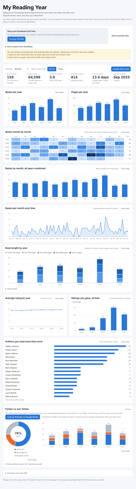

# My Reading Year

Upload your Goodreads library export and see your reading as a set of charts, in the spirit of a year-end listening recap but for books.

Goodreads shows books and pages per year. This shows much more:

- Books and pages read per year, and per month (year-by-month heatmap)
- Reading pace: average days between finished books, longest gap, pages per month over time
- Book length ranges per year: under 100, 100-299, 300-499, 500-999, 1,000+ pages
- Average rating you give, by year, and how your ratings are spread across 1 to 5 stars
- Authors you have read more than once
- Fiction vs non-fiction split, by year and overall
- A **Save image** button on every chart, and a **share card** (portrait PNG with your totals, a bar chart and a few facts, in dark or light, with an optional name)
- A year filter that updates the stats

## Privacy

Everything runs in your browser. Your CSV is read locally and is never uploaded anywhere. There is no server, account or database.

The one exception is the optional genre lookup. It only runs when you click the button, and it sends the ISBN (or title and author) of the books it needs to look up to the Google Books API. Results are cached in your browser's local storage, as are any genre tags you set yourself.

## How to use it

1. On goodreads.com (on a computer), go to **My Books**, then **Import and export**, then **Export Library**.
2. Download the CSV when it is ready.
3. Open the live site (link in the repo's About section), then drop the CSV on the page.

To try it first, use **Show example data**, or upload `sample/sample_goodreads_export.csv`.

## How fiction vs non-fiction is decided

1. Your own tags win. Click the Genre button next to any book to set it.
2. Next, your Goodreads shelves: a shelf named `fiction` (or ending in `-fiction`, like `science-fiction`) counts as fiction, and `non-fiction` counts as non-fiction.
3. For the rest, the lookup asks Google Books for the book's categories. Any category containing "fiction" counts as fiction. Anything else with a category counts as non-fiction.

Google's categories are broad, so expect a few mistakes. Books with no answer stay as "No genre yet" and can be tagged by hand.

## Notes on the data

- Only books on your **Read** shelf with a **Date Read** are counted. Books without a finish date are listed in a notice and left out of the charts.
- A rating of 0 in the export means "not rated" and is left out of averages.
- Books with no page count are left out of page charts.
- The export has only a finish date, not a start date, so pace is measured by gaps between finish dates.

## Run it locally

It is a single static file. Open `index.html` in a browser. No build step.

## Roadmap

- [x] Fiction vs non-fiction split
- [x] Download each chart as an image
- [x] Shareable summary card
- [ ] Save last upload in the browser so you do not have to re-upload
- [ ] Compare two exports (for example, this year against last year)

## License

MIT
